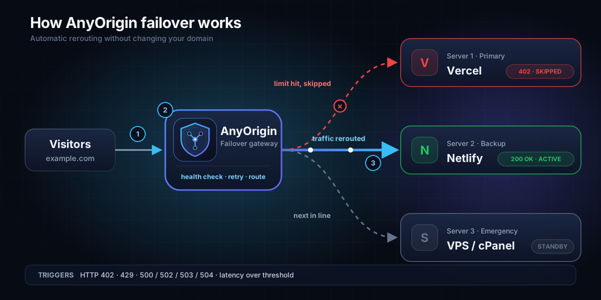
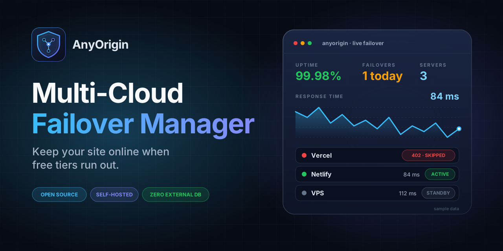

<div align="center">


# AnyOrigin

A zero-dependency, self-hosted traffic coordinator and failover manager for web applications.

[](https://php.net)
[-003B57.svg?style=flat-square)](https://sqlite.org)
[](https://github.com/themubiin/AnyOrigin)
[](LICENSE)

<br/>

Chain multiple hosting providers (Vercel, Netlify, Render, VPS, cPanel) behind one domain. If your primary host crashes or exhausts free-tier bandwidth, AnyOrigin switches visitors to your standby servers in under a second.

<br/>

[Quickstart](#quickstart) &bull;
[How It Works](#how-it-works) &bull;
[Features](#features) &bull;
[Comparison](#comparison) &bull;
[FAQ](#faq)

---

</div>

<br/>

## Why this exists

Modern hosting platforms like Vercel and Netlify have generous free plans, but their hard limits can catch you off guard:

1. **Quota halts:** When you hit free bandwidth or execution caps, Vercel serves an immediate `402 Payment Required` or `429 Too Many Requests`. Your site stops cold.
2. **Expensive alternatives:** Cloudflare Load Balancing starts at $15/month with per-origin billing, and AWS Route 53 requires complex DNS failover configurations.
3. **Database overhead:** Most self-hosted reverse proxies or managers require running PostgreSQL, Redis, or Docker daemon services just to store a couple of host URLs.

AnyOrigin was built to solve this simply: drop a lightweight PHP proxy on any shared cPanel or $3 VPS, configure your upstream hosts through a web UI, and let it handle failovers automatically. No external database, no monthly cloud bills.

---

## How It Works

<div align="center">
  
</div>

```
                            Incoming Request (example.com)
                                          │
                                          ▼
                      ┌───────────────────────────────────────┐
                      │               index.php               │
                      │  (Fast-path ingress • < 1ms overhead) │
                      └───────────────────┬───────────────────┘
                                          │
                     ┌────────────────────┼───────────────────┐
                     ▼ (Tier 1)           │                   │
          ┌─────────────────────┐         │                   │
          │    Vercel Primary   │         │                   │
          │  🔴 Returns 402/429 │         │                   │
          └──────────┬──────────┘         │                   │
                     │                    ▼ (Tier 2 - 0.2s)   │
                     │ Failover   ┌─────────────────────┐     │
                     └───────────>│   Netlify Standby   │     │
                                  │   🟢 Serves 200 OK  │     │
                                  └─────────────────────┘     ▼ (Tier 3 - Fallback)
                                                     ┌─────────────────────┐
                                                     │    Self-Hosted VPS  │
                                                     │      ⚪ Hot Standby │
                                                     └─────────────────────┘
```

1. Incoming requests enter through `index.php`.
2. The proxy reads the active routing table from an in-memory cached JSON file (`data/config.json`). This takes under 0.1ms and avoids querying SQLite on every request.
3. It tries Tier 1 (e.g. Vercel). If it returns a failover status code (`402`, `429`, `5xx`) or times out, it instantly retries Tier 2 (e.g. Netlify).
4. The response headers, status code, and body stream directly back to the visitor.

---

## Quickstart

AnyOrigin requires PHP 8.1+ with the `curl` and `pdo_sqlite` extensions (standard on almost all cPanel shared hosts and Linux distributions).

### Installation

1. Clone or download the repository into your web root (e.g. `public_html/` on cPanel or `/var/www/html` on VPS):
   ```bash
   git clone https://github.com/themubiin/AnyOrigin.git .
   ```
2. Navigate to `https://yourdomain.com/anyorigin` in your browser.
3. Log in with the default password:
   ```
   admin123
   ```
4. Add your upstream origins (e.g. `https://my-app.vercel.app` as Primary, `https://my-app.netlify.app` as Standby).
5. Change the default password in the console.

That is it. Visitor traffic arriving at `yourdomain.com` is now automatically routed and failover-protected.

---

## Features

### Host & Redirect Rewriting
When routing traffic to multi-tenant backends (such as `my-app.netlify.app`), sending the visitor's original `Host` header can cause Netlify or Vercel to return a 404 because the custom domain has not been registered inside that secondary project.
* AnyOrigin automatically adjusts the upstream `Host` header to match the destination project.
* It passes `X-Forwarded-Host` and `X-Forwarded-Proto` so the backend application generates correct absolute links.
* If the upstream server responds with a redirect (`Location: https://my-app.netlify.app/dashboard`), AnyOrigin intercepts and rewrites the header back to `https://yourdomain.com/dashboard`, keeping visitors on your primary domain.
* `Set-Cookie` domain attributes are rewritten to bind directly to your primary domain.

### Idempotency Protection (Safe POST Retries)
Safe idempotent methods (`GET`, `HEAD`, `OPTIONS`) can be retried on any server failure. However, blindly retrying `POST` or `PUT` requests when an upstream server returns a `500` error or drops the connection could cause duplicate database entries or repeated payment charges.
* AnyOrigin retries `POST` requests **only** if the upstream server returns `HTTP 402` (payment/quota limit) or `HTTP 429` (rate limit). In these cases, the platform rejected the request before execution, making a retry safe.
* Retries on `5xx` errors for `POST` requests are disabled to protect data integrity.

### SSRF Protection
The admin console validates origin URLs to prevent Server-Side Request Forgery (SSRF). Private IPv4/IPv6 ranges (`127.0.0.1`, `10.0.0.0/8`, `192.168.0.0/16`, `172.16.0.0/12`) and cloud metadata endpoints (`169.254.169.254`) are rejected.

### Zero Database Server
All origin configurations and failover settings are stored locally in `data/anyorigin.db` via SQLite with Write-Ahead Logging (WAL) enabled. No MySQL, PostgreSQL, or Redis configuration is needed.

---

## Comparison

| Feature | AWS Route 53 / Cloudflare LB | Standard Nginx Reverse Proxy | **AnyOrigin** |
| :--- | :---: | :---: | :---: |
| **Pricing** | $15 to $50+/month | Free | **Free & Open Source** |
| **Setup Complexity** | High (DNS health checks & routing policies) | Medium (manual conf editing & reloads) | **Low (single folder upload, web UI)** |
| **External Dependencies** | Vendor cloud infrastructure | Nginx runtime | **PHP 8.1+ & SQLite** |
| **HTTP 402 Detection** | No (only basic TCP/HTTP pings) | Requires custom Lua scripts | **Built-in native trigger** |
| **cPanel Compatibility** | N/A | Requires root access | **100% Drop-in** |

---

## Preview

<div align="center">
  
</div>

---

## Repository Structure

```
├── .htaccess             # Directs visitors to index.php and console requests to /anyorigin
├── index.php             # Fast-path ingress proxy (< 1ms overhead)
├── anyorigin/            # Management console
│   ├── bootstrap.php     # SQLite initialization and cache sync
│   ├── index.php         # Main dashboard
│   └── login.php         # Console authentication
├── assets/               # Visual assets and diagrams
├── data/
│   ├── .htaccess         # Blocks public browser access to data files
│   └── .gitkeep
└── scripts/
    └── test-failover.php # Standalone verification test (php scripts/test-failover.php)
```

---

## FAQ

**Can this run on shared cPanel hosting?**  
Yes. As long as your hosting provides PHP 8.1+ with `curl` and `pdo_sqlite` enabled (default on nearly all cPanel providers), AnyOrigin works without needing terminal access or root permissions.

**Will visitor sessions stay logged in when switching hosts?**  
AnyOrigin forwards `Cookie`, `Set-Cookie`, and `Authorization` headers. For user sessions to persist across different hosts (e.g. from Vercel to Netlify), your web application should use stateless authentication (like JWT tokens) or a shared database (such as Supabase, Neon, Firebase, or external MySQL).

**What throughput can it handle?**  
Because `index.php` reads routing rules from an in-memory JSON cache without framework bootstrapping, its proxy overhead is typically under 1ms. On a modest VPS or cPanel server, it can comfortably handle 100,000+ requests per day.

---

## License

[MIT](LICENSE)
