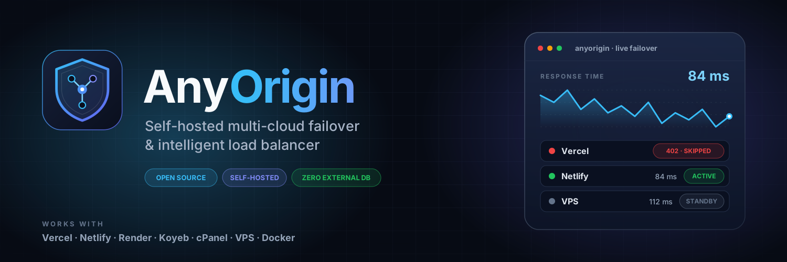
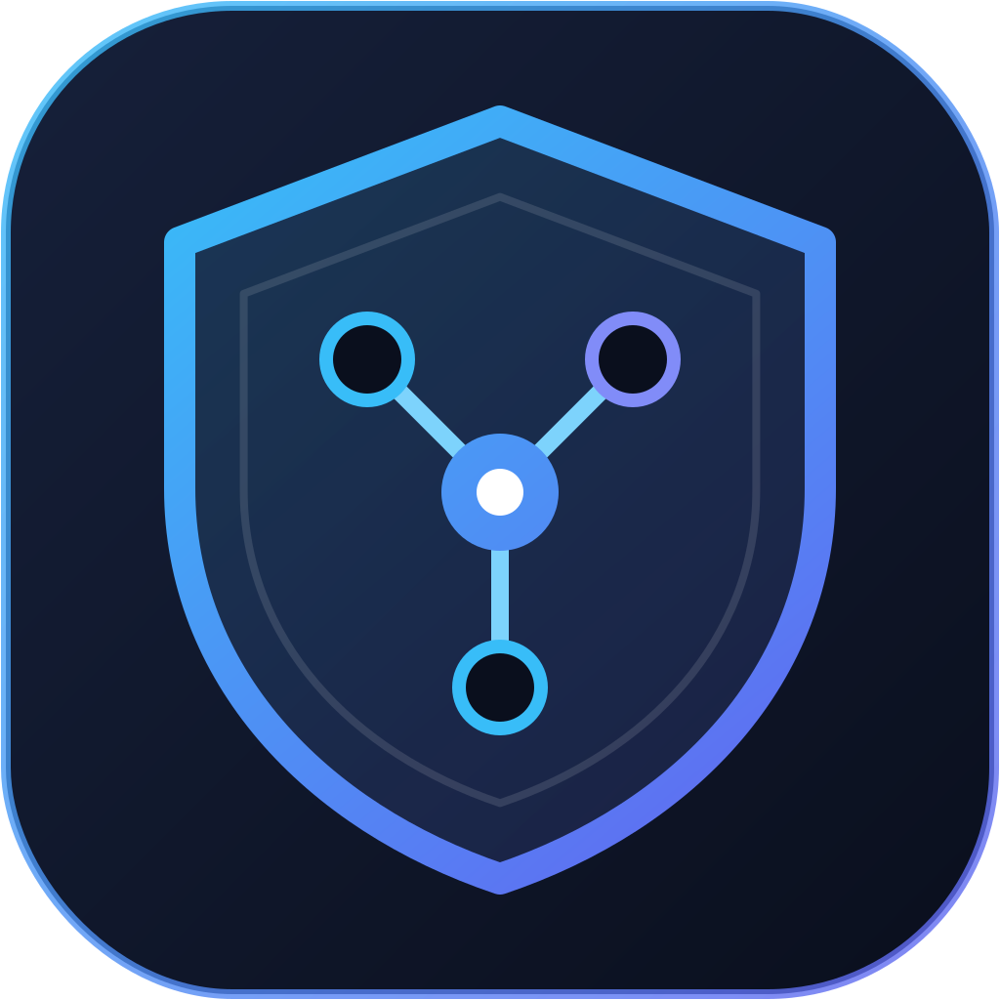

<div align="center">



<br/>



# AnyOrigin
### The Zero-Dependency, Self-Hosted Multi-Cloud Load Balancer & Failover Manager

[](https://php.net)
[-003B57.svg?style=flat-square&logo=sqlite&logoColor=white)](https://sqlite.org)
[](https://github.com/themubiin/AnyOrigin)
[-38bdf8.svg?style=flat-square)](https://github.com/themubiin/AnyOrigin)
[](LICENSE)

<br/>

**Unite Vercel, Netlify, Render, cPanel, and VPS into one unbreakable website — with ZERO cloud fees, NO external databases, and NO Cloudflare dependency.**

<br/>

[🚀 1-Minute Quickstart](#-1-minute-beginner-quickstart-cpanel--vps) •
[📐 Architecture](#-how-traffic-failover-works) •
[✨ Key Features](#-key-features) •
[📊 Comparison](#-how-does-anyorigin-compare) •
[🛡️ Smart Protections](#-built-in-enterprise-protections) •
[❓ FAQ](#-frequently-asked-questions)

---

</div>

<br/>

## 📐 How Traffic Failover Works

<div align="center">
  
</div>

```
                                  Incoming Visitor
                               (https://example.com)
                                         │
                                         ▼
                     ┌───────────────────────────────────────┐
                     │     AnyOrigin Fast-Path Ingress       │
                     │  (index.php • Microsecond Cache Read) │
                     └───────────────────┬───────────────────┘
                                         │
                    ┌────────────────────┼───────────────────┐
                    ▼ (Try #1)           │                   │
         ┌─────────────────────┐         │                   │
         │   Vercel Primary    │         │                   │
         │  (Free Tier Limit)  │         │                   │
         │ 🔴 HTTP 402/429 Hit │         │                   │
         └──────────┬──────────┘         │                   │
                    │                    ▼ (Try #2 - 0.2s)   │
                    │ Failover   ┌─────────────────────┐     │
                    └───────────>│   Netlify Standby   │     │
                                 │   🟢 200 OK Served  │     │
                                 └─────────────────────┘     ▼ (Try #3 - Disaster Recovery)
                                                    ┌─────────────────────┐
                                                    │ Self-Hosted VPS/App │
                                                    │    ⚪ Hot Standby   │
                                                    └─────────────────────┘
```

> **Why AnyOrigin?**  
> Modern hosting platforms (Vercel, Netlify) offer generous free tiers, but shut down your website the moment bandwidth or invocation quotas run out (`HTTP 402 Payment Required` or `429 Rate Limit`).  
> **AnyOrigin turns multiple free-tier hosts into an enterprise-grade, high-availability cluster.** When your primary host fails, AnyOrigin redirects the visitor to a backup host in under 1 second without dropping user sessions or showing an error screen.

---

## ⚡ 1-Minute Beginner Quickstart (cPanel / VPS)

AnyOrigin is designed to be **100% plug-and-play**. No `npm run build`, no Docker, no Node.js background services, and no MySQL setup required!

### Step 1: Upload Files
Upload the repository files directly into your cPanel `public_html/` folder (or git clone on your VPS / Apache / Nginx server).

```bash
git clone https://github.com/themubiin/AnyOrigin.git
```

### Step 2: Open the Dashboard
Navigate to `https://yourdomain.com/admin` in your web browser.

* **Default Admin Password:** `admin123` *(changeable directly inside the dashboard with 1 click)*.

### Step 3: Add Your Hosts
Add your hosting URLs in priority order:
1. **Primary Host:** `https://my-app.vercel.app` 🟢
2. **Standby Host:** `https://my-app.netlify.app` 🟡
3. **Emergency Backup:** `https://my-vps-server.com` ⚪

**🎉 That's it! Your website is now fully protected against cloud limits and server downtime.**

---

## ✨ Key Features

| Capability | What It Does |
| :--- | :--- |
| ⚡ **100k+ Req/Day Fast-Path** | Public visitors hit `index.php`, which reads cached rules in memory (< 1ms overhead). Handles high traffic easily on cheap $3 VPS or cPanel. |
| 🛡️ **Sub-Second Failover** | Instant in-flight switching on `HTTP 402`, `429`, `500`, `502`, `503`, `504`, or network timeouts. |
| 💾 **Zero External Database** | Automatically creates and uses a local embedded SQLite database (`data/anyorigin.db`). No PostgreSQL, MySQL, or Redis needed. |
| 🔄 **Smart Header & Redirect Rewriting** | Rewrites upstream `Host` and `Location` redirect headers so visitors stay on `example.com` and are never bounced away to Netlify/Vercel URLs. |
| 💳 **Idempotency & Safe POST Guard** | Protects e-commerce sites by never blindly retrying `POST` requests on `500` server errors to prevent duplicate payments. |
| 🔒 **SSRF Shield** | Blocks malicious internal IP scanning (`127.0.0.1`, `10.0.0.0/8`, `192.168.0.0/16`, AWS metadata `169.254.169.254`). |

---

## 📊 How Does AnyOrigin Compare?

| Feature | AWS Route 53 / Cloudflare LB | Typical Reverse Proxy (Nginx) | **AnyOrigin** 🛡️ |
| :--- | :---: | :---: | :---: |
| **Monthly Cost** | 💲 $15 - $50+/month | 💲 Free (Manual Config) | **💲 100% Free & Open Source** |
| **No Cloudflare Dependency** | ❌ Requires Cloudflare | ✅ Yes | **✅ Yes (100% Self-Hosted)** |
| **Zero-Config Database** | ❌ Cloud managed | ❌ N/A | **✅ SQLite Embedded** |
| **HTTP 402 Quota Detection** | ❌ Only checks basic ping | ❌ Requires custom Lua scripts | **✅ Built-in Native Trigger** |
| **Beginner Friendly UI** | ⚠️ Complex AWS/Cloud Console | ❌ Raw config files only | **✅ Clean, Modern Dark Dashboard** |
| **Setup Time** | 30 - 60 minutes | 20 - 45 minutes | **⚡ Under 60 Seconds** |

---

## 🛡️ Built-in Enterprise Protections

### 1. Transparent Host & Location Rewriting
When routing traffic to a backup provider (e.g. `my-app.netlify.app`), sending the client's `Host: example.com` header causes modern multi-tenant platforms to return a 404. Furthermore, upstream redirects (`Location: https://my-app.netlify.app/dashboard`) would leak the backup URL.  
* AnyOrigin automatically adapts the upstream `Host` header.  
* Rewrites upstream `Location` headers so all redirects point cleanly to `https://example.com/dashboard`.  
* Rewrites `Set-Cookie` domain attributes to match your primary domain.

### 2. Safe POST Protection (Anti-Double Charge)
Safe methods (`GET`, `HEAD`, `OPTIONS`) can be retried across any failure. But retrying `POST` requests after a `500` crash can lead to duplicate orders or double billing.  
* AnyOrigin safely retries `POST` **only** when the cloud platform explicitly returns `402` or `429` (guaranteeing the server rejected the request before execution).  
* Blind retries on `500` server crashes are suppressed to keep financial data safe.

### 3. SSRF Shield
AnyOrigin strictly blocks attempts to configure origins pointing to private subnets or instance metadata:
* `127.0.0.0/8` (Loopback / Localhost)
* `10.0.0.0/8`, `172.16.0.0/12`, `192.168.0.0/16` (Private networks)
* `169.254.169.254` (Cloud instance metadata)

---

## 🌐 Community & Preview

<div align="center">
  
</div>

---

## 📁 Repository Structure

```
├── .htaccess             # Ingress router (sends visitors to index.php, admin to /admin)
├── index.php             # Fast-Path Ingress Proxy Engine (< 1ms overhead, 100k+ req/day)
├── admin/                # Beginner-friendly dark dashboard
│   ├── bootstrap.php     # SQLite schema & config cache compiler
│   ├── index.php         # Main dashboard (host priority, rules, ping tests)
│   └── login.php         # Admin authentication
├── assets/               # Brand assets, logos, and architecture diagrams
├── data/
│   ├── .htaccess         # Protects database from direct public browser download
│   └── .gitkeep
└── scripts/
    └── test-failover.php # Standalone test suite (run: php scripts/test-failover.php)
```

---

## ❓ Frequently Asked Questions

<details>
<summary><b>Can I run this on shared cPanel hosting?</b></summary>
Yes! AnyOrigin runs natively on standard cPanel shared hosting with PHP 8.1+. You do not need root access, Node.js, or SSH. Simply upload the files to your <code>public_html/</code> directory.
</details>

<details>
<summary><b>How does AnyOrigin handle user logins and sessions?</b></summary>
AnyOrigin transparently forwards all <code>Cookie</code>, <code>Set-Cookie</code>, and <code>Authorization</code> headers. For sessions to persist seamlessly when switching hosts, your web application should use stateless authentication (such as JWT tokens) or an external database (e.g. Supabase, Firebase, Neon, or MySQL).
</details>

<details>
<summary><b>Do I need a separate MySQL database?</b></summary>
No! AnyOrigin automatically creates and maintains a local embedded SQLite database in <code>data/anyorigin.db</code>. It is completely zero-configuration.
</details>

<details>
<summary><b>How does it achieve 100k+ requests per day on cheap hosting?</b></summary>
The public-facing engine (<code>index.php</code>) does not boot heavy application frameworks on incoming requests. It reads an ultra-fast compiled cache (<code>data/config.json</code>) in microseconds, adding less than 1ms of latency overhead.
</details>

---

## 📄 License

MIT License. Free for personal, commercial, and agency use.
Built with ❤️ for developers who love uptime without cloud bills.
